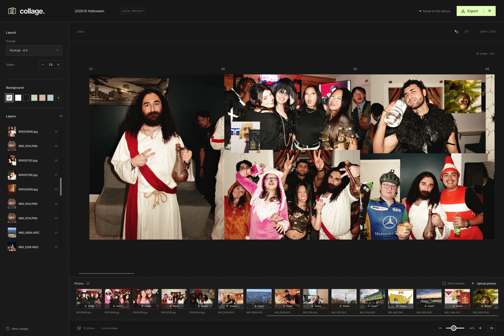

# Collage

Local, client-only slideshow creator



## The Story

The app I used for making my Instagram slides went to a really shit freemium model that limited users to 5 slides per carousel. I didn't like that. Good thing that code is free nowadays.

I decided to make _collage_, a free, open-source slideshow creator. Because fuck paying for stuff lol


## Run

Node 22.12+.

```sh
npm install
npm run dev
```

`npm run build` type-checks and builds `dist/`. `npm run preview` serves the production build. Deploy `dist/` to any static host.

## Deployment

Production: https://collage.gabech.com.

Push a version tag to deploy the tagged commit through `.github/workflows/deploy.yml`:

```sh
git tag v1.0.0
git push origin v1.0.0
```

Tags matching `v[0-9]*` deploy (for example, `v1` or `v1.0.0`); ordinary branch pushes do not. Commit and push the app changes you want to release before tagging. The workflow also supports **Run workflow** in GitHub Actions for a manual deployment of the selected ref.

Actions uses Node 22, runs `npm ci` and `npm run build`, then syncs `dist/` to `/srv/collage/dist/` on Hetzner over SSH. Deployments are serialized; stale files are removed after transfer. It verifies the public HTML and a JavaScript asset against the build. Caddy serves the static files directly and manages HTTPS; no app process or restart is needed.

Repository Actions secrets: `VPS_HOST`, `VPS_USERNAME`, `VPS_SSH_KEY`, and `VPS_KNOWN_HOSTS`. Collage uses a dedicated SSH key authorized as `github-actions-collage` on Hetzner with forwarding and PTY disabled; the pinned host key comes from Hetzner's SSH host key. `/srv/collage/dist/` must be writable by the deployment user and readable by Caddy.

The server's `/etc/caddy/Caddyfile` includes:

```caddyfile
collage.gabech.com {
	root * /srv/collage/dist
	@html path / /index.html
	header @html Cache-Control "no-cache"
	@assets path /assets/*
	header @assets Cache-Control "public, max-age=31536000, immutable"
	file_server
}
```

## Controls

- Upload with the file picker or file drag/drop. Photos stay in the bottom tray; uploads never place them automatically.
- Click Insert or drag a tray photo onto a slide. Touch dragging is supported. Sources can be reused in multiple placements; deleting a placement keeps its tray photo.
- Inserted photos are hidden from the tray by default. Toggle Show inserted to reveal them.
- Sort by upload order, natural filename, or EXIF capture date, in either direction. Photos without capture dates stay last; file modification dates are not substituted.
- Right-click a tray photo to insert, replace the selected photo, or delete it. Canvas/layer menus include duplicate, layer order, crop reset, replacement, grouping, lock/hide and delete. Icon menus fit their longest action and support arrow keys and Escape.
- Tray trash buttons also work on touch devices. Deleting an uploaded photo removes its placements after confirmation if in use; one Undo restores the photo and placements.
- Select a photo: drag its edges to crop width/height independently; corners resize proportionally; top handle rotates. Drag the photo to move it.
- Crop width/height fields provide exact dimensions. Reset crop restores the original image without changing its scale.
- Shift-click, drag a selection rectangle from empty canvas, or toggle Multi-select to select several photos. Cmd/Ctrl+A selects editable photos. Group keeps selection together; drag/corner resize moves/scales the group in one Undo step, preserving member crops and rotations.
- Alignment/distribution acts on selected photos or whole groups. Distribution requires three independent photos/groups.
- Replace from the photo tools/file picker or a tray photo's context menu. The frame's position, size, rotation and layer order stay fixed; the new source is center-cropped to fill it. The old source remains in the library.
- Layer lock prevents selection/transforms; hidden layers are omitted from canvas and export. Group flags apply to every member. Use Layers on mobile to show/unlock them again.
- Wheel or trackpad pinch zooms around the pointer; touch pinch zooms around its midpoint. Shift-scroll or horizontal trackpad scroll pans horizontally. Each wheel gesture stays in one mode despite diagonal noise; it never also scrolls vertically. Touch-drag empty canvas to pan. Fit shows the whole strip (minimum 10% zoom).
- Arrow keys nudge selection; Shift moves 10px. Delete removes it. Cmd/Ctrl+Z undoes; Shift+Cmd/Ctrl+Z redoes.
- Slides: 1–20. Portrait: 1080×1350; square: 1080×1080. Shrinking the strip hides out-of-bounds artwork; increasing it reveals it again.
- Reorder slides toggles an inline toolbar with each slide number above its thumbnail—no modal or arrow buttons. Drag thumbnails to reorder, including on touch; dragging near an edge scrolls the strip. Keyboard: focus a thumbnail and use Left/Right.
- Every slide reorders independently. Photos follow the slide containing their visual centre; groups use the centre of their combined bounds and move together, including hidden/locked members. Crossing photos stay whole, so overlaps can change. Crop, size, rotation, stacking and grouping stay unchanged; one Undo restores the move. Centres on a seam use the slide to its right; off-strip centres use the nearest edge.
- Right-click a slide thumbnail (or focus it and press Shift+F10) for Delete slide. Uses the same centre-based ownership: removes that slide's photo placements and whole groups, including hidden/locked members, then shifts later slides left. Uploaded originals stay available; one Undo restores everything. The final slide cannot be deleted.
- Projects opens the project list: create, switch, rename, duplicate or delete. Edits save before switching; Undo history is scoped to the open project. Duplicates share originals until a photo is replaced.
- Export project backup saves an editable ZIP with all originals, staged photos, placements and settings. It also works with unsaved edits after a storage error. Import backup creates a separate project and leaves existing projects intact.
- Export numbered PNGs individually or in a ZIP. Native file sharing is offered when supported; saving directly to Photos depends on the device/browser. Downloads save PNG files; preview images also support long-press saving.

## Storage and source

Projects autosave in IndexedDB on this device and origin. Full-resolution sources are stored once as binary Blobs, separately from a lightweight project catalog and thumbnails; edits never rewrite originals. Browser storage quotas vary by device/browser and available disk space; there is no app-imposed upload count limit. Clearing browser data removes all local projects. No images leave the browser.

Quota errors identify unsaved changes without discarding the open project. Failed loads or migrations never autosave a blank replacement; catalog/source migration and backup import commit atomically. A failed save blocks project switching. Export a project backup before closing or reloading a tab with a storage error. Backup import/export needs memory for the archive and originals; very large backups can hit browser memory limits.

Deleted sources remain available for the current tab's Undo history. On the next workspace load, sources no longer referenced by **any saved project** are removed, reclaiming their storage. Deleting a project does not remove originals still used by another project.

- `src/model.ts`: separate source assets and canvas placements; source-pixel crops.
- `src/crop.ts`: crop geometry; preserves scale and rotated placement.
- `src/assets.ts`: local HEIC conversion, EXIF capture dates, binary source storage, 192px thumbnails and shared 1280px editing previews.
- `src/storage.ts`: atomic project catalog/source transactions, legacy migration and cross-project unused-source cleanup.
- `src/useProject.ts`: project-scoped undo/redo, serialized project operations and local persistence.
- `src/backup.ts`: full-original editable ZIP export/import with source-ID remapping.
- `src/selection.ts`, `src/slides.ts`, `src/replacement.ts`: grouped geometry, centre-based slide reordering/deletion and frame-preserving source replacement.
- `src/components/ProjectManager.tsx`, `src/components/SlideReorder.tsx`: on-demand project dialog and inline slide toolbar.
- `src/components/SlideThumbnail.tsx`: SVG slide composites using existing 192px source thumbnails, including crops, rotation, stacking, backgrounds and visibility.
- `src/components/LayersPanel.tsx`, `src/components/SelectionToolbar.tsx`: shared layer/selection controls.
- `src/components/CollageCanvas.tsx`: viewport-sized, offscreen-culled rendering, transforms, snapping and zoom.
- `src/components/CropHandles.tsx`: direct edge cropping with live preview and a single undo step per drag.
- `src/components/PhotoTray.tsx`: windowed upload library, filtering, sorting, insertion, deletion and desktop/touch dragging.
- `src/components/ContextMenu.tsx`: shared, viewport-clamped keyboard-accessible photo and slide actions.
- `src/export.ts`: sequential full-resolution slide rendering, bounded decoded-source cache and ZIP generation.
- `src/components/ExportDialog.tsx`: previews, native sharing, individual downloads.

Modern browser required. HEIC/HEIF uploads convert locally to full-resolution PNG with `heic-to/csp`; JPEG, PNG and WebP retain their original source files. Editing uses bounded previews; exports use full-resolution sources and render one slide at a time rather than allocating a full 20-slide bitmap.
